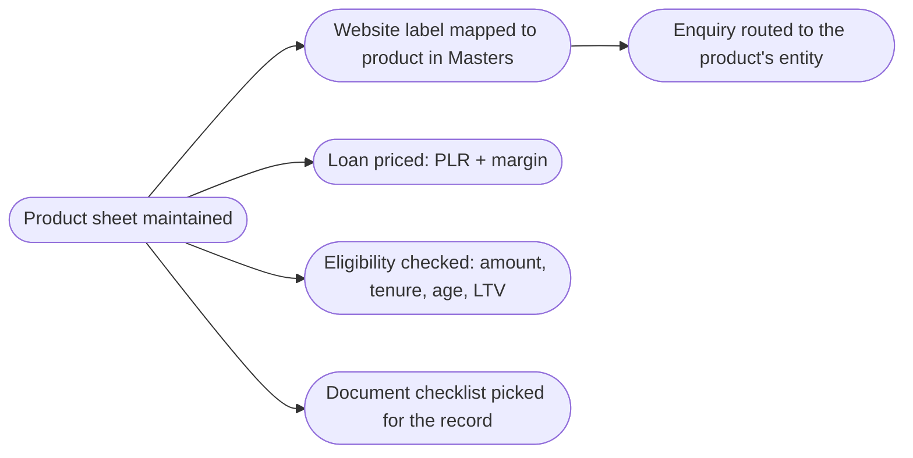

# 01 — Products & Services

<!-- nav:top -->
> **[Docs roadmap](../../README.md)** › **[Process flows](README.md)** › 2 of 22 · **For:** Business users
> ← [00 — Purpose](00-purpose.md) · [02 — Clients (Client 360)](02-clients-client-360.md) →
> New to Genesis? Background: [Understanding Genesis › The building blocks](../../understanding/02-building-blocks.md)
<!-- /nav:top -->

**Sidebar:** Client 360 ▸ Products & Services

## What it is for

The catalogue of every product and service the group sells. Each product sheet holds the terms the rest of the CRM
reads: which entity sells it, the margin over the PLR, minimum amount, maximum tenure, age limit, risk rating and the
document checklist. Enquiries are routed, loans are priced and documents are requested from these values.

## Who works here

| Role | Does |
|---|---|
| CRM administrator | Maintains product sheets |
| Everyone | Reads them (visible to all staff) |

## Records

| Record | Holds |
|---|---|
| **Product** | Legal entity, description, features, eligibility, security and insurance, documents required, fees, who it is for, how to apply, website page, checklist, risk rating, margin, limits, live **Rate from** |

The 22 products cover Lending (Real Estate, Personal, Investment-Backed, Commercial), Wealth Management, six funds,
four securities services, three advisory services and four forex services.

## The flow at a glance

## Step by step

| Step | Who | What to do | What the CRM does |
|---|---|---|---|
| 1 | Administrator | Open **Products & Services ▸ New** (or edit an existing product) and fill the sheet | Calculates **Rate from** = current PLR + product margin |
| 2 | Administrator | Pick the document checklist the product's applications should use | Applications of that product show this checklist on their Docs tab |
| 3 | Administrator | In **Masters ▸ Product routing**, map each website label to the product code and business unit | Website enquiries for that label reach the right desk |
| 4 | — | When the PLR changes in **Masters ▸ PLR history** | **Rate from** and loan pricing update by themselves |
| 5 | Any staff | Open a product sheet when talking to a client | — |

## Rules and controls

- Loan applications read margin, minimum amount, maximum tenure, maximum age at maturity and maximum financing from
  the product. Changing the product changes eligibility for new calculations.
- Product risk rating feeds the suitability check on wealth, fund and trading recommendations.

## Where to see results

- Products are listed in the module; the website preview (`/site/<workspace>`) shows the live PLR and rates.

## Related flows

[Enquiries & Leads](03-enquiries-and-leads.md) · [Retail Lending](05-retail-lending.md) · [Masters](19-masters.md)

<!-- nav:bottom -->

---

### Where to next

| | |
|---|---|
| **Next** | [02 — Clients (Client 360)](02-clients-client-360.md) — One client record for the group, relationships, the Client 360 view |
| **Previous** | [00 — Purpose](00-purpose.md) |
| **Background** | [Understanding Genesis › The building blocks](../../understanding/02-building-blocks.md) |
| **Lost?** | [Docs roadmap](../../README.md) · [Process flows](README.md) · [Understanding Genesis](../../understanding/README.md) |
<!-- /nav:bottom -->
