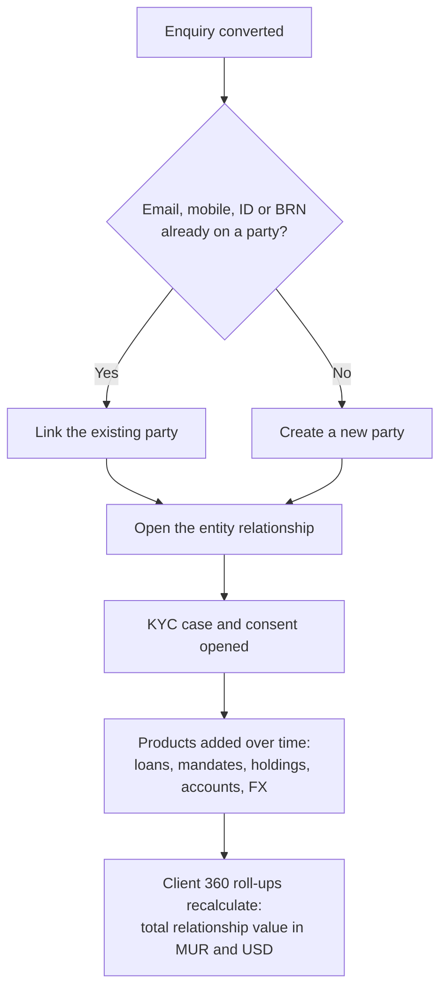

# 02 — Clients (Client 360)

<!-- nav:top -->
> **[Docs roadmap](../../README.md)** › **[Process flows](README.md)** › 3 of 22 · **For:** Business users
> ← [01 — Products & Services](01-products-and-services.md) · [03 — Enquiries & Leads](03-enquiries-and-leads.md) →
> New to Genesis? Background: [Understanding Genesis › How data is stored and read](../../understanding/03-how-data-is-stored.md)
<!-- /nav:top -->

**Sidebar:** Client 360 ▸ Clients

## What it is for

One **golden record** per client — person or company — shared by every entity in the group. It is the starting
point for any client conversation: the **Related** tab shows everything the group does with the client, and the
calculated Client 360 figures show the whole relationship in one place.

## Who works here

| Role | Does |
|---|---|
| Relationship manager | Owns clients, keeps details current, starts conversations here |
| Every desk | Reads the client and links its own records to it |
| Compliance, credit, operations | May reveal masked personal data |
| Managers | Merge duplicates, reassign books |

## Records

| Record | Holds |
|---|---|
| **Party** | Identity, contact, segment, preferred language and channel, KYC status, AML risk, PEP and VIP flags, Client 360 figures |
| **Household & Group** | Families and corporate groups, with aggregated value and the group lending limit |
| **Client Relationship** | One per entity the client deals with, with its own stage and RM |
| **Party Relationship** | Spouse, director, shareholder %, beneficial owner, signatory, guarantor, power of attorney |
| **Addresses & Phones** | Contact points with verification and a preferred flag |
| **Consents** | Permission per purpose and channel, with withdrawal |

## The flow at a glance

Client Relationship stages, one per entity:

How a client record comes to exist and grows:

## Step by step

| Step | Who | What to do | What the CRM does |
|---|---|---|---|
| 1 | Loans executive / RM | Convert a qualified enquiry ([flow 03](03-enquiries-and-leads.md)) — or create the party directly with **New** | Matches on email, mobile, national ID and BRN; links instead of duplicating; opens the relationship |
| 2 | RM | Complete identity, contact, segment, preferred language and channel | Masks ID number and income band for roles without personal-data rights |
| 3 | RM | Add household / group, party relationships (directors, UBOs, guarantors) and contact points | Aggregates household and group value |
| 4 | Any desk | Create its own records (loan, mandate, order, FX deal…) against the party | Rolls up loans outstanding, AUM, fund holdings, securities value, FX volume, products held, open applications and complaints |
| 5 | RM | Read the **Related** tab before any client meeting | Shows every linked record; barrier-protected rows show as "N restricted — contact Compliance" |
| 6 | — | Daily | Raises reminders on key dates: birthday, ID expiry, profile refresh, loan maturity, FMB 2029, mandate review, KYC review; raises next-best actions ([flow 04](04-cross-sell-and-rm-workbench.md)) |
| 7 | Manager | Found a duplicate: open it ▸ **Merge into…** ▸ pick the record to keep | Moves every linked record, activity, task, reminder, document and email to the kept party; the duplicate's SLA timers stop and it goes to Trash; reversible for 30 days |
| 8 | Manager | RM leaves: select their clients ▸ **Reassign** | Ownership moves in bulk |

## Rules and controls

- **Personal data** (ID number, income band) is encrypted and masked. **Reveal** is recorded in the tamper-evident
  audit chain.
- **VIP clients** sit in the `VIP_CLIENTS` barrier zone; only named users see them and every view is audited.
- **Search** covers every object but respects business units and barriers.
- A party has no business unit: it is shared by every entity. Its relationships and products carry the unit.

## Where to see results

- The party record itself (Client 360 fields and Related tab).
- **Group Executive** dashboard: total relationship value, cross-sell.
- **My Workbench**: an RM's own clients and actions.

## Related flows

[Enquiries & Leads](03-enquiries-and-leads.md) · [Cross-sell & RM Workbench](04-cross-sell-and-rm-workbench.md) ·
[KYC & Compliance](18-kyc-and-compliance.md) · [Marketing & Consent](14-marketing-and-consent.md)

<!-- nav:bottom -->

---

### Where to next

| | |
|---|---|
| **Next** | [03 — Enquiries & Leads](03-enquiries-and-leads.md) — Capture, routing, qualification and conversion of enquiries |
| **Previous** | [01 — Products & Services](01-products-and-services.md) |
| **Background** | [Understanding Genesis › How data is stored and read](../../understanding/03-how-data-is-stored.md) |
| **Lost?** | [Docs roadmap](../../README.md) · [Process flows](README.md) · [Understanding Genesis](../../understanding/README.md) |
<!-- /nav:bottom -->
