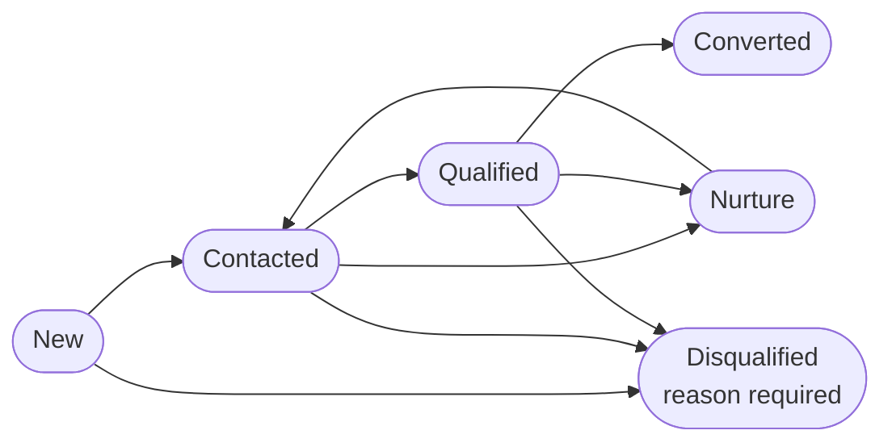

# 03 — Enquiries & Leads

<!-- nav:top -->
> **[Docs roadmap](../../README.md)** › **[Process flows](README.md)** › 4 of 22 · **For:** Business users
> ← [02 — Clients (Client 360)](02-clients-client-360.md) · [04 — Cross-sell & RM Workbench](04-cross-sell-and-rm-workbench.md) →
> New to Genesis? Background: [Understanding Genesis › What happens automatically](../../understanding/06-what-happens-automatically.md)
<!-- /nav:top -->

**Sidebar:** Client 360 ▸ Enquiries & Leads

## What it is for

Every request from a prospect or client — website form, loan calculator, investor questionnaire, call-back, phone,
walk-in, event, introducer or internal referral — lands here as an **enquiry**. The CRM routes it to the right entity
and person, acknowledges it, scores it and times the first contact. Converting it creates the client, the KYC case
and, for retail loans, the loan application.

## Who works here

| Role | Does |
|---|---|
| Loans executive, RM, dealer, advisor | Contacts, qualifies and converts enquiries routed to them |
| BD / unit head | Watches the funnel and speed to lead |
| Marketing | Reads attribution (channel, campaign, UTM) |

## Records

| Record | Holds |
|---|---|
| **Enquiry** | Contact details, product, amount and tenure, channel, campaign / introducer, consent, lead score and grade, indicative rate and instalment |
| **Calculator Session** | Anonymous website calculator, newsletter and call-back events |
| **Referral** | One entity referring a client to another, with the referrer's credit |

## The flow at a glance

## Step by step

| Step | Who | What to do | What the CRM does |
|---|---|---|---|
| 1 | Client / staff | Client submits a website form, or staff create the enquiry with **New** for a phone call or walk-in | Creates the enquiry at *New* |
| 2 | — | Immediately | **Routes** it: website label → product → entity → executive (round robin within the desk). An existing client's enquiry goes to their RM. A *Talk to* link goes to the named person |
| 3 | — | Immediately | **Acknowledges** the client by email in English or French; scores it **A–F** with a formula (amount, existing client, contact details given, marketing consent, referral channel); calculates indicative rate and instalment for loans; flags possible duplicates; starts the **speed-to-lead** timer |
| 4 | Owner | Call the client ▸ move to **Contacted** | First-contact timer stops (target 4 business hours) |
| 5 | Owner | Confirm need, amount and tenure ▸ **Qualified** | — |
| 6a | Owner | Not ready yet ▸ **Nurture** | Kept for later contact |
| 6b | Owner | Not a fit ▸ **Disqualified** with a reason code | Reason feeds the Lead Funnel dashboard |
| 7 | Owner | Ready to proceed ▸ **Converted** | Creates or links the **party**, opens the **entity relationship** and the **KYC case**, records **marketing consent** if given, and for Real Estate, Personal or Investment-Backed loans opens the **loan application** at *Pre-qualified*. Notifies the owner |
| 8 | Owner | Continue in the next module: [KYC](18-kyc-and-compliance.md), [Retail Lending](05-retail-lending.md), [Wealth](09-wealth-management.md)… | — |

### Variations

| Source | What happens first |
|---|---|
| **Investor questionnaire** (website) | Creates a risk profile; if no client is attached, the CRM creates a Wealth enquiry carrying the provisional model portfolio |
| **Call-back request** | Becomes an enquiry for Forex, Loans or Investments depending on the topic, and is acknowledged |
| **Quick loan estimate** | Stays an anonymous calculator session (no personal details) |
| **Newsletter sign-up** | Welcomed by email and passed to Marketing ([flow 14](14-marketing-and-consent.md)) |
| **Introducer referral** | Creates and routes the enquiry, credited to the introducer ([flow 15](15-introducers.md)) |
| **Internal referral** | One entity passes a client to another; the receiving desk must accept within one business day |

## Rules and controls

- **Converted** needs first name, last name and email — and, for a loan product, amount and tenure.
- **Disqualified** needs a reason code.
- Conversion never duplicates a client: an email already on a party links to it.
- Public forms are rate-limited, validated and can use reCAPTCHA; the consent text and version are stored.

## Timers (SLAs)

| Timer | Target |
|---|---|
| Speed to lead — first contact | 4 business hours (warning at 75%) |
| Enquiry resolved (converted or closed) | 10 business days |
| Internal referral accepted | 1 business day |

## Where to see results

- **Lead Funnel** dashboard: funnel, channels, products, grades, disqualification reasons.
- **My Workbench**: my open enquiries.
- **SLA Board**: enquiries on track, at risk or breached.

## Related flows

[Clients](02-clients-client-360.md) · [Retail Lending](05-retail-lending.md) · [Introducers](15-introducers.md) ·
[Client Portal and web forms](21-client-and-introducer-portal.md)

<!-- nav:bottom -->

---

### Where to next

| | |
|---|---|
| **Next** | [04 — Cross-sell & RM Workbench](04-cross-sell-and-rm-workbench.md) — Opportunities, next-best actions, meeting notes and RM targets |
| **Previous** | [02 — Clients (Client 360)](02-clients-client-360.md) |
| **Background** | [Understanding Genesis › What happens automatically](../../understanding/06-what-happens-automatically.md) |
| **Lost?** | [Docs roadmap](../../README.md) · [Process flows](README.md) · [Understanding Genesis](../../understanding/README.md) |
<!-- /nav:bottom -->
