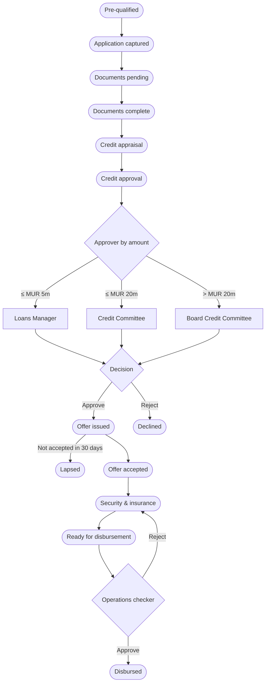

# 05 — Retail Lending

<!-- nav:top -->
> **[Docs roadmap](../../README.md)** › **[Process flows](README.md)** › 6 of 22 · **For:** Business users
> ← [04 — Cross-sell & RM Workbench](04-cross-sell-and-rm-workbench.md) · [06 — Commercial Lending](06-commercial-lending.md) →
> New to Genesis? Background: [Understanding Genesis › What happens automatically](../../understanding/06-what-happens-automatically.md)
<!-- /nav:top -->

**Sidebar:** Lending ▸ Retail Lending

## What it is for

Takes a retail loan — Real Estate, Personal or Investment-Backed — from a converted enquiry to money paid out.
The CRM prices the loan from the PLR, checks eligibility, pulls the credit bureau report, requests documents, routes
the credit decision to the right authority, issues the offer letter, checks security and books the loan in the loan
management system (LMS) with a maker-checker step.

## Who works here

| Role | Does |
|---|---|
| Loans executive | Owns the application from capture to disbursement |
| Credit analyst | Appraises, grades and recommends |
| Loans Manager / Credit Committee / Board Credit Committee | Approve by amount |
| Operations checker | Checks and releases the disbursement (never the maker) |
| Client | Supplies documents, signs the offer |

## Records

| Record | Holds |
|---|---|
| **Loan Application** | Product, purpose, amount, tenure, repayment type, income and obligations, property value; calculated PLR, margin, rate, EMI, total interest, LTV, DSR, age at maturity, eligibility, approval level |
| **Applicant & Guarantor** | Each applicant's income and obligations |
| **Credit Condition** | Conditions precedent and subsequent |
| **Offer Scenario** | Alternative tenures and instalments to compare |
| **Disbursement** | Tranches: *Requested → Checker review → Sent to LMS → Booked* |

## The flow at a glance

*Withdrawn* is available from any open stage when the client steps back.

## Step by step

| Step | Who | What to do | What the CRM does |
|---|---|---|---|
| 1 | Loans executive | Convert the enquiry ([flow 03](03-enquiries-and-leads.md)) | Opens the application at *Pre-qualified* with product, amount and tenure; opens the KYC case |
| 2 | Loans executive | Run the KYC case in parallel ([flow 18](18-kyc-and-compliance.md)) | — |
| 3 | Loans executive | Enter income, obligations, property value and MCIB consent ▸ **Application captured** | Pulls the **MCIB** report (with consent) and stores score and reference; calculates rate (PLR + margin), EMI, total interest, LTV, DSR, age at maturity and eligibility; emails the client a status update |
| 4 | Loans executive | Optional: add **Offer Scenarios** to compare tenures | Shows instalment and total interest per scenario |
| 5 | Loans executive | ▸ **Documents pending** | Emails the client the product checklist with a **secure upload link**; the Docs tab shows each item as received or outstanding |
| 6 | Client | Uploads documents through the link or the portal | Files land on the Docs tab for review |
| 7 | Loans executive | Review each document (approve or reject with reason) ▸ **Documents complete** | A rejected document reopens its item |
| 8 | Loans executive | ▸ **Credit appraisal** | Refused if the application is outside policy and no exceptions are recorded |
| 9 | Credit analyst | Set risk grade, recommendation, conditions ▸ **Credit approval** | Sends an approval to the right authority by amount |
| 10 | Approver | **Tools ▸ Approvals** ▸ review ▸ Approve or Reject with a comment | Approve: moves to *Offer issued*. Reject: moves to *Declined*, generates the **decline letter** and emails the client |
| 11 | — | On *Offer issued* | Records the PLR priced on; generates the **PDF offer letter** and emails the client; for real-estate loans refers the client for life and building insurance; offer valid 30 days |
| 12 | Loans executive | Send the offer for **e-signature** from the Docs tab | Tracks *Pending → Viewed → Signed* and files the certificate |
| 13 | Loans executive | Offer signed ▸ **Offer accepted** ▸ **Security & insurance**: valuation, notary, charge registration, insurance assignment, pledge | Calculates *security complete* |
| 14 | Loans executive | Enter the disbursement amount ▸ **Ready for disbursement** | Sends an approval to the **operations checker** |
| 15 | Operations checker | **Tools ▸ Approvals** ▸ Approve | Books the loan in the **LMS** and records the account number. Reject sends it back to *Security & insurance* |
| 16 | Loans executive | ▸ **Disbursed** | Closes the application; creates the **loan account** in the loan book ([flow 08](08-loan-servicing.md)); for real-estate loans ≥ MUR 5m refers the client to Wealth |

### Staged (construction) disbursements

1. Create a **Disbursement** per tranche under the application at *Requested*.
2. Move it to **Checker review** — allowed only when all conditions precedent are met.
3. The operations checker (never the requester) approves; the tranche is booked in the LMS and moves to **Booked** with
   its reference and value date.

## Rules and controls

| Gate | Rule |
|---|---|
| Application captured | Monthly income and property value required |
| Credit appraisal | Eligible, or policy exceptions recorded |
| Credit approval | Risk grade and analyst recommendation required |
| Offer issued | Only after an approved credit decision |
| Ready for disbursement / Disbursed | Security complete **and** client KYC approved; disbursement amount and LMS reference required |

- Eligibility: age at maturity ≤ 65; tenure and LTV from the product; Personal Loan minimum MUR 500k; Investment-Backed
  Loan only for existing fund or securities clients.
- Unaccepted offers **lapse** automatically after 30 days.
- The client gets an email in their language at each milestone: captured, documents complete, appraisal, offer
  accepted, security, disbursed.

## Timers (SLAs)

| Timer | Target |
|---|---|
| Application picked up | 1 business day |
| Application to decision and disbursement | 20 business days |
| Disbursement tranche checked / booked | 1 / 2 business days |

## Where to see results

- **Lending Pipeline**: pipeline by stage, DSR, exceptions, decisions, decline reasons, tranches.
- **SLA Board**: applications and disbursements at risk.

## Related flows

[Enquiries & Leads](03-enquiries-and-leads.md) · [KYC & Compliance](18-kyc-and-compliance.md) ·
[Collateral & Pledges](07-collateral-and-pledges.md) · [Loan Servicing](08-loan-servicing.md) · [Tools](20-tools.md)

<!-- nav:bottom -->

---

### Where to next

| | |
|---|---|
| **Next** | [06 — Commercial Lending](06-commercial-lending.md) — Credit facilities, financial spreads and covenants |
| **Previous** | [04 — Cross-sell & RM Workbench](04-cross-sell-and-rm-workbench.md) |
| **Background** | [Understanding Genesis › What happens automatically](../../understanding/06-what-happens-automatically.md) |
| **Lost?** | [Docs roadmap](../../README.md) · [Process flows](README.md) · [Understanding Genesis](../../understanding/README.md) |
<!-- /nav:bottom -->
