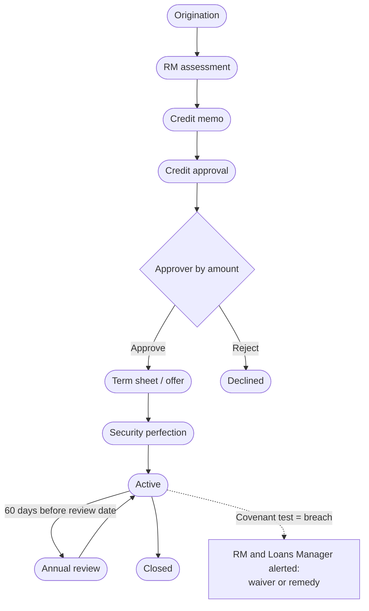

# 06 — Commercial Lending

<!-- nav:top -->
> **[Docs roadmap](../../README.md)** › **[Process flows](README.md)** › 7 of 22 · **For:** Business users
> ← [05 — Retail Lending](05-retail-lending.md) · [07 — Collateral & Pledges](07-collateral-and-pledges.md) →
> New to Genesis? Background: [Understanding Genesis › What happens automatically](../../understanding/06-what-happens-automatically.md)
<!-- /nav:top -->

**Sidebar:** Lending ▸ Commercial Lending

## What it is for

Corporate credit facilities from origination through the credit memo, approval, term sheet and security to an active
facility — then covenant monitoring and the annual review. Group exposure is tracked against the group limit.

## Who works here

| Role | Does |
|---|---|
| Corporate RM | Originates, assesses and owns the facility |
| Credit analyst | Spreads the financials, writes the credit memo |
| Loans Manager / Credit Committee / Board Credit Committee | Approve by amount |
| Loans Manager | Decides waivers on covenant breaches |

## Records

| Record | Holds |
|---|---|
| **Commercial Facility** | Type, tranche, tenor, margin, fees, credit memo (background, SWOT, projections, security package), risk grade, group exposure |
| **Financial Spreading** | P&L and balance sheet by year; calculated EBITDA margin, gearing, interest cover, DSCR |
| **Covenant** | The condition the borrower must keep (for example DSCR ≥ 1.25x) |
| **Covenant Test** | Result on a test date: pass or breach, with waiver |

## The flow at a glance

## Step by step

| Step | Who | What to do | What the CRM does |
|---|---|---|---|
| 1 | Corporate RM | **New** facility for the company ▸ *Origination* ▸ **RM assessment** | Shows the client group's existing exposure against the group limit |
| 2 | Credit analyst | Enter **Financial Spreading** rows per year | Calculates EBITDA margin, gearing, interest cover, DSCR |
| 3 | Credit analyst | Write company background and security package ▸ **Credit memo** | — |
| 4 | Credit analyst | Set recommendation and risk grade ▸ **Credit approval** | Sends an approval by amount: ≤ MUR 5m Loans Manager, ≤ MUR 20m Credit Committee, above that Board Credit Committee |
| 5 | Approver | **Tools ▸ Approvals** ▸ Approve or Reject | Approve: moves to *Term sheet / offer* and generates the **term sheet**. Reject: *Declined* |
| 6 | RM | Agree terms ▸ **Security perfection** (charges, guarantees, insurance) | — |
| 7 | RM | ▸ **Active** | Refused unless the borrower's KYC is approved |
| 8 | RM | Add **Covenants**; record **Covenant Tests** on test dates | A breach alerts the RM and Loans Manager to decide a waiver or remedy; test dates appear in the calendar feed |
| 9 | — | Daily, 60 days before the review date | Moves the facility to **Annual review** and asks the RM to request updated financials |
| 10 | RM / credit | Re-spread, re-assess and renew ▸ back to *Active*, or ▸ **Closed** | — |

## Rules and controls

| Gate | Rule |
|---|---|
| Credit memo | Company background and security package required |
| Credit approval | Recommendation and risk grade required |
| Term sheet / offer | Only after an approved decision |
| Active | Borrower KYC approved |

- Corporates in tourism, trade or manufacturing without FX cover receive an **FX hedging** next-best action
  ([flow 04](04-cross-sell-and-rm-workbench.md)).

## Timers (SLAs)

| Timer | Target |
|---|---|
| Credit memo to decision | 10 business days |

## Where to see results

- **Lending Pipeline** and **Loan Book** dashboards.

## Related flows

[Collateral & Pledges](07-collateral-and-pledges.md) · [Loan Servicing](08-loan-servicing.md) ·
[Clients — groups and exposure](02-clients-client-360.md) · [Forex Desk](13-forex-desk.md)

<!-- nav:bottom -->

---

### Where to next

| | |
|---|---|
| **Next** | [07 — Collateral & Pledges](07-collateral-and-pledges.md) — Collateral, valuations, links and margin calls |
| **Previous** | [05 — Retail Lending](05-retail-lending.md) |
| **Background** | [Understanding Genesis › What happens automatically](../../understanding/06-what-happens-automatically.md) |
| **Lost?** | [Docs roadmap](../../README.md) · [Process flows](README.md) · [Understanding Genesis](../../understanding/README.md) |
<!-- /nav:bottom -->
