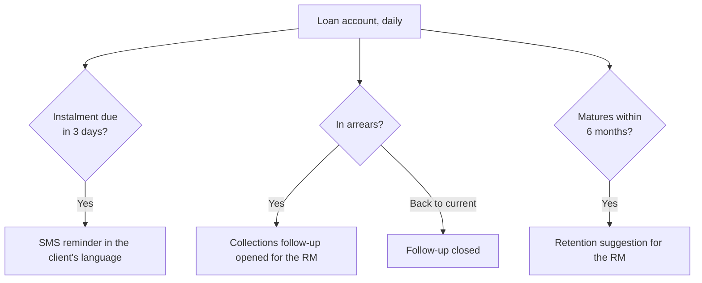

# 08 — Loan Servicing

<!-- nav:top -->
> **[Docs roadmap](../../README.md)** › **[Process flows](README.md)** › 9 of 22 · **For:** Business users
> ← [07 — Collateral & Pledges](07-collateral-and-pledges.md) · [09 — Wealth Management](09-wealth-management.md) →
> New to Genesis? Background: [Understanding Genesis › What happens automatically](../../understanding/06-what-happens-automatically.md)
<!-- /nav:top -->

**Sidebar:** Lending ▸ Loan Servicing

## What it is for

Looks after loans once they are booked. The loan book is a daily snapshot from the loan management system (LMS). The
CRM reminds borrowers before each instalment, notifies every variable-rate borrower when the Prime Lending Rate (PLR)
changes, opens collections follow-ups on arrears and raises retention conversations before maturity.

## Who works here

| Role | Does |
|---|---|
| Loans Manager | Approves PLR change campaigns |
| Loans executive / RM | Follows up arrears and maturities |
| Administrator | Records the new PLR in Masters |

## Records

| Record | Holds |
|---|---|
| **Loan Book (LMS view)** | Account number, outstanding, rate, instalment, next due date, arrears days and amount, maturity, LTV, status |
| **PLR Change Campaign** | Old and new rate, effective date, approver |
| **PLR Notice** | Per account: old and new instalment, channel, sent date |
| **Collections action** | Call, letter, promise to pay, escalation, outcome |

## The flow at a glance

PLR change campaign:

Daily servicing sweeps:

## Step by step

### A. A new loan enters the book

1. A disbursed application creates the **loan account** with the LMS account number ([flow 05](05-retail-lending.md)).
2. The LMS snapshot refreshes outstanding, instalment, arrears and next due date.

### B. PLR change

| Step | Who | What to do | What the CRM does |
|---|---|---|---|
| 1 | Loans executive | **New** PLR Change Campaign with old rate, new rate and effective date (stays in **Draft**) | — |
| 2 | Loans Manager | Fill **Approved by** (the ALCO decision) ▸ **Approved** — refused without it | Every variable-rate, unsettled account gets a **PLR Notice** with its old and new rate and instalment (same balance and remaining term) and a personalised letter on the notice's Docs tab; the campaign moves itself to **Notices generated** and the loans manager is notified |
| 3 | Loans Manager | ▸ **Distributed** | Each pending notice is emailed to the borrower in their language, logged on its Activity, marked **Sent** with the date |
| 4 | Administrator | On the effective date, add the new rate in **Masters ▸ PLR history** | Product **Rate from**, new loan pricing and the loans' current rate follow. The campaign never changes the PLR itself |

### C. Instalments and arrears

| Step | Who | What to do | What the CRM does |
|---|---|---|---|
| 1 | — | 3 days before each instalment | Sends the borrower an SMS reminder |
| 2 | — | Account enters arrears | Opens a **collections** follow-up (call) for the RM with the arrears bucket |
| 3 | RM | Call, log the outcome, record a **promise to pay** with amount and date (refused without both), escalate if needed | The promised date is written on the loan account (**Promise to pay by**); an escalation to legal alerts the loans manager |
| 4 | — | Account back to current | Closes the follow-up |

### D. Maturity

1. Six months before maturity the CRM raises a **retention** next-best action for the RM.
2. The RM discusses a new need or reinvestment ([flow 04](04-cross-sell-and-rm-workbench.md)).

### E. Service requests on a loan

Early settlement quotes, statements, title release and similar requests are raised in
[Service & Complaints](17-service-and-complaints.md) from the service catalogue.

## Where to see results

- **Loan Book** dashboard: outstanding by product, arrears buckets (1–30, 31–60, 61–90, 90+), LTV bands, PLR-linked
  share, collections.

## Related flows

[Retail Lending](05-retail-lending.md) · [Collateral & Pledges](07-collateral-and-pledges.md) ·
[Service & Complaints](17-service-and-complaints.md) · [Masters](19-masters.md)

<!-- nav:bottom -->

---

### Where to next

| | |
|---|---|
| **Next** | [09 — Wealth Management](09-wealth-management.md) — Risk profiles, suitability, mandates and AUM |
| **Previous** | [07 — Collateral & Pledges](07-collateral-and-pledges.md) |
| **Background** | [Understanding Genesis › What happens automatically](../../understanding/06-what-happens-automatically.md) |
| **Lost?** | [Docs roadmap](../../README.md) · [Process flows](README.md) · [Understanding Genesis](../../understanding/README.md) |
<!-- /nav:bottom -->
