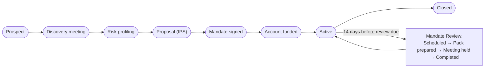

# 09 — Wealth Management

<!-- nav:top -->
> **[Docs roadmap](../../README.md)** › **[Process flows](README.md)** › 10 of 22 · **For:** Business users
> ← [08 — Loan Servicing](08-loan-servicing.md) · [10 — Investment Funds](10-investment-funds.md) →
> New to Genesis? Background: [Understanding Genesis › What happens automatically](../../understanding/06-what-happens-automatically.md)
<!-- /nav:top -->

**Sidebar:** Investments ▸ Wealth Management

## What it is for

Runs the wealth relationship: profiling the investor's risk, recording suitability for every recommendation,
taking a mandate from first meeting to an active, funded portfolio, then reviewing it on its cycle and watching for
signs the client may leave. House-view changes from the Strategic Asset Allocation Committee (SAAC) are logged and
pushed to portfolio managers.

## Who works here

| Role | Does |
|---|---|
| Relationship manager | Discovery, profiling, proposal |
| Portfolio manager | Manages the mandate, prepares reviews, applies SAAC decisions |
| Client | Completes the questionnaire, signs the mandate and IPS, attends reviews |

## Records

| Record | Holds |
|---|---|
| **Risk Profile** | Questionnaire answers scored to a model portfolio (A–E) and a risk ceiling (1–5); valid two years |
| **Suitability Record** | Each recommendation with rationale and risks disclosed; override and client acknowledgement when above the ceiling |
| **Wealth Mandate** | Type (discretionary, advisory, execution-only), benchmark, custodian, fees, AUM, performance, review cycle, attrition risk |
| **Mandate Review** | *Scheduled → Pack prepared → Meeting held → Completed* |
| **AUM Snapshot** | Monthly AUM by asset class, performance and flows |
| **SAAC Decision** | House-view change, affected models and allocation change |

## The flow at a glance

## Step by step

### A. New mandate

| Step | Who | What to do | What the CRM does |
|---|---|---|---|
| 1 | RM | Create the mandate at **Prospect** (or from an accepted next-best action / enquiry) | — |
| 2 | RM | Hold the discovery meeting, log a **Meeting Note** ▸ **Discovery meeting** | Meeting appears in the calendar feed |
| 3 | RM / client | Complete the **Risk Profile** (or the client fills the website **investor questionnaire**) ▸ **Risk profiling** | Scores to model portfolio A–E and a risk ceiling; valid two years |
| 4 | RM | Prepare the Investment Policy Statement ▸ **Proposal (IPS)** | Refused without a linked risk profile |
| 5 | RM | Record a **Suitability Record** for the recommendation | Refused if the profile has expired; if product risk exceeds the ceiling, refused until an override reason and the client's acknowledgement are recorded |
| 6 | RM | Mandate and IPS signed (e-signature from Docs) ▸ **Mandate signed** | — |
| 7 | Portfolio manager | ▸ **Account funded** | Refused unless the client's KYC is approved |
| 8 | Portfolio manager | ▸ **Active** | AUM rolls up to the client's Client 360 |

### B. Running the mandate

| Step | Who | What to do | What the CRM does |
|---|---|---|---|
| 1 | Portfolio manager | Record monthly **AUM Snapshots** | Feeds performance, net flows and the Wealth dashboard |
| 2 | Portfolio manager | File the monthly client report under *Monthly client reports* and **Share** it by secure link | Tracks views and downloads |
| 3 | — | 14 days before the review is due | Opens a **Mandate Review** at *Scheduled* |
| 4 | Portfolio manager | Prepare the pack ▸ **Pack prepared** | Invites the client to the meeting in their language |
| 5 | Portfolio manager | ▸ **Meeting held** (date) ▸ **Completed** (outcome, minutes) | *Completed* is refused until suitability is re-confirmed |
| 6 | — | Daily | Falling AUM, missed reviews or a complaint → **attrition risk** task for the RM, once |
| 7 | — | Every two years | Flags risk profiles due for refresh |
| 8 | Investment committee | Record a **SAAC Decision** | Notifies portfolio managers to brief affected clients |

Top-ups and withdrawals are raised as service requests ([flow 17](17-service-and-complaints.md)).

## Rules and controls

| Gate | Rule |
|---|---|
| Proposal (IPS) | Risk profile linked |
| Account funded | Client KYC approved |
| Review completed | Outcome, minutes and suitability re-confirmed |
| Suitability record | Valid profile; override and acknowledgement above the ceiling |

## Where to see results

- **Wealth** dashboard: AUM by model portfolio, mandate pipeline, net flows, reviews, suitability overrides.
- **My Workbench**: reviews due.

## Related flows

[Investment Funds](10-investment-funds.md) · [Trading Solutions](11-trading-solutions.md) ·
[KYC & Compliance](18-kyc-and-compliance.md) · [Cross-sell](04-cross-sell-and-rm-workbench.md)

<!-- nav:bottom -->

---

### Where to next

| | |
|---|---|
| **Next** | [10 — Investment Funds](10-investment-funds.md) — Funds, share classes, NAV, orders and holdings |
| **Previous** | [08 — Loan Servicing](08-loan-servicing.md) |
| **Background** | [Understanding Genesis › What happens automatically](../../understanding/06-what-happens-automatically.md) |
| **Lost?** | [Docs roadmap](../../README.md) · [Process flows](README.md) · [Understanding Genesis](../../understanding/README.md) |
<!-- /nav:bottom -->
