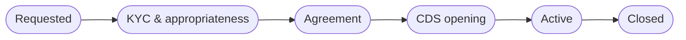
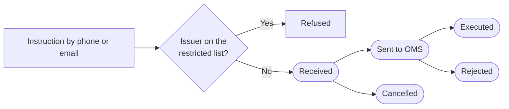

# 11 — Trading Solutions

<!-- nav:top -->
> **[Docs roadmap](../../README.md)** › **[Process flows](README.md)** › 12 of 22 · **For:** Business users
> ← [10 — Investment Funds](10-investment-funds.md) · [12 — Corporate Advisory](12-corporate-advisory.md) →
> New to Genesis? Background: [Understanding Genesis › What happens automatically](../../understanding/06-what-happens-automatically.md)
<!-- /nav:top -->

**Sidebar:** Investments ▸ Trading Solutions

## What it is for

The securities business: opening trading accounts (with KYC, appropriateness and a CDS account), logging every client
instruction with a timestamp and handing it to the order management system (OMS), collecting indications of interest
for IPOs and bond issues, and distributing research to subscribers.

## Who works here

| Role | Does |
|---|---|
| Trader | Opens accounts, logs and executes orders, runs the IPO / bond book |
| RM | Introduces clients, follows dormant accounts |
| Research | Publishes notes and weekly highlights |

## Records

| Record | Holds |
|---|---|
| **Securities Account** | Account type, markets, custodian, settlement bank, CDS and OMS account numbers, limits, authorised instructors |
| **Order Intake Log** | Instrument, market, side, quantity, price type, channel, received time, OMS reference, executed price |
| **IPO / Bond Book** | Indications of interest per client |
| **Research & Market Statistics** | Publications, topic, sent flag, opens |

## The flow at a glance

Account opening:

Order intake:

## Step by step

### A. Open a trading account

| Step | Who | What to do | What the CRM does |
|---|---|---|---|
| 1 | Trader / RM | **New** securities account at *Requested* | — |
| 2 | Trader | Check KYC and the client's understanding of the products ▸ **KYC & appropriateness** | — |
| 3 | Trader | Agreement signed, appropriateness OK ▸ **Agreement** | Both fields required |
| 4 | Operations | Request the CDS account ▸ **CDS opening** | — |
| 5 | Trader | Enter the CDS account number ▸ **Active** | Refused unless the client's KYC is approved |

### B. Take an order

| Step | Who | What to do | What the CRM does |
|---|---|---|---|
| 1 | Trader | **Order Intake Log ▸ New**: account, instrument, market, side, quantity, price type, channel, received time | Refuses the order if the issuer is on the **restricted list** |
| 2 | Trader | ▸ **Sent to OMS** | Hands the order to the OMS and records its reference (best-execution evidence) |
| 3 | Trader | ▸ **Executed** with executed price | OMS reference and price required |

### C. IPO or bond issue

1. Record each client's indication of interest in the **IPO / Bond Book**.
2. Allocate when the book closes.

### D. Distribute research

1. Create a **Research** publication (note, weekly highlights, market report).
2. Press **Send to subscribers**: every active subscriber of that topic is emailed in their language; clients without
   marketing consent are skipped.
3. *Sent* is ticked and **Opens** counts recipients who opened it (an estimate: some mail apps block images).

### E. Dormant accounts

An account with no trade for 12 months raises a **reactivation** next-best action for the RM
([flow 04](04-cross-sell-and-rm-workbench.md)).

## Rules and controls

- KYC approved before activation; agreement and appropriateness before the agreement stage.
- Restricted-list block on orders. New restricted issuers are announced to traders and portfolio managers; watch-list
  entries stay with Compliance ([flow 18](18-kyc-and-compliance.md)).
- Corporate advisory deals are invisible to traders (information barrier).

## Where to see results

- **Trading** dashboard: accounts, orders by market, consideration, IPO / bond book.

## Related flows

[KYC & Compliance](18-kyc-and-compliance.md) · [Marketing — subscriptions](14-marketing-and-consent.md) ·
[Corporate Advisory](12-corporate-advisory.md)

<!-- nav:bottom -->

---

### Where to next

| | |
|---|---|
| **Next** | [12 — Corporate Advisory](12-corporate-advisory.md) — Mandates, conflict checks, deal teams, insider lists, fees |
| **Previous** | [10 — Investment Funds](10-investment-funds.md) |
| **Background** | [Understanding Genesis › What happens automatically](../../understanding/06-what-happens-automatically.md) |
| **Lost?** | [Docs roadmap](../../README.md) · [Process flows](README.md) · [Understanding Genesis](../../understanding/README.md) |
<!-- /nav:bottom -->
