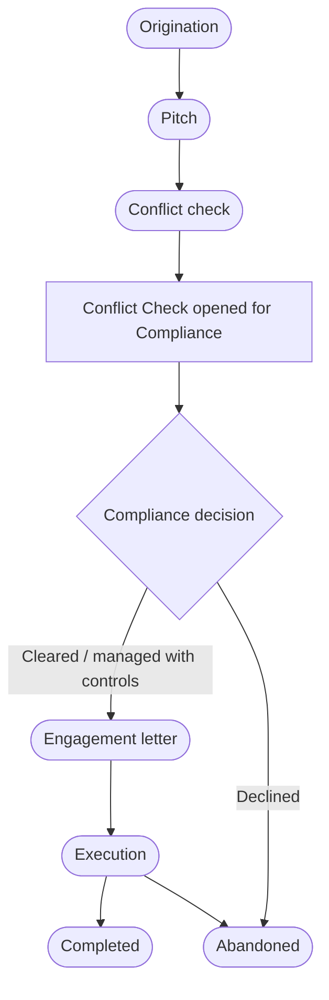
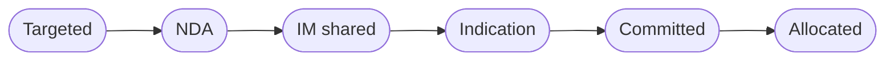

# 12 — Corporate Advisory

<!-- nav:top -->
> **[Docs roadmap](../../README.md)** › **[Process flows](README.md)** › 13 of 22 · **For:** Business users
> ← [11 — Trading Solutions](11-trading-solutions.md) · [13 — Forex Desk](13-forex-desk.md) →
> New to Genesis? Background: [Understanding Genesis › Who sees what](../../understanding/05-who-sees-what.md)
<!-- /nav:top -->

**Sidebar:** Advisory ▸ Corporate Advisory — **behind the advisory information barrier**

## What it is for

Runs corporate finance mandates — fund raising, valuation and business plans, restructuring — under code names and
behind a Chinese wall. Compliance clears conflicts before the engagement letter; everyone on the deal team is added to
the insider list automatically; the investor book is gated by NDAs; fees are invoiced on milestones.

Only members of the `ADV_PRIVATE` barrier zone see these records — administrators included. Other users see
"N restricted — contact Compliance" in related lists.

## Who works here

| Role | Does |
|---|---|
| Corporate advisor | Originates and runs the mandate |
| Advisory analyst | Deal team work: deliverables, time, investor book |
| Compliance officer | Decides the conflict check, watches the insider list |

## Records

| Record | Holds |
|---|---|
| **Advisory Mandate** | Code name, client, service line, fees (retainer, success), stage |
| **Conflict Check** | *Requested → Compliance review → Decided*: cleared, managed with controls, or declined |
| **Deal Team** | Staff on the deal |
| **Insider List** | Everyone holding inside information, with date, time and reason |
| **Investor Bookbuilding** | *Targeted → NDA → IM shared → Indication → Committed → Allocated* |
| **Deliverables & Milestones** | *Drafting → In review → Approved → Delivered to client*, with milestone fee |
| **Time & Effort** | Hours per person per day |
| **Fee Invoice** | Retainer, milestone and success fees |
| **Tombstones & Credentials** | Completed deals for future pitches |

## The flow at a glance

Investor book for each investor:

## Step by step

| Step | Who | What to do | What the CRM does |
|---|---|---|---|
| 1 | Advisor | **Advisory Mandates ▸ New** with a **project code name** ▸ **Pitch** | Record sits behind `ADV_PRIVATE` |
| 2 | Advisor | ▸ **Conflict check** | Opens a **Conflict Check** for Compliance |
| 3 | Compliance | Review the group's relationships, exposure, open mandates and the restricted list; set the decision (controls required for *managed*) ▸ **Decided** | Writes the decision back to the mandate and keeps it as the audit record; adds to the conflicts register |
| 4 | Advisor | Cleared ▸ **Engagement letter** | Refused unless cleared; generates the **engagement letter** (by code name) for e-signature |
| 5 | Advisor | Letter signed ▸ **Execution** | Signed flag required |
| 6 | Advisor | Add **Deal Team** members | Each is added to the **Insider List** automatically with date, time and reason |
| 7 | Analyst | Build the **investor book**: target ▸ NDA signed ▸ share the information memorandum by **secure link** ▸ record indication ▸ commitment ▸ allocation | IM can be shared only after the NDA is signed; an indication only after the NDA; share analytics count views |
| 8 | Analyst | Log **Time & Effort**; produce **Deliverables** through review | A delivered deliverable with a milestone fee raises a **Fee Invoice** for accounting |
| 9 | Advisor | ▸ **Completed** (or **Abandoned**); add a **Tombstone** | Revenue posts to the ledger ([flow 16](16-revenue.md)) |

## Rules and controls

- Barrier: deal records, their documents and notifications stay inside `ADV_PRIVATE`. Traders cannot see that a deal
  exists.
- Anyone else who needs access requests a **wall-crossing** ([flow 20](20-tools.md)); Compliance approves it for a
  limited time and the person joins the insider list.
- Engagement letter only after a cleared conflict check; IM and indications only after a signed NDA.

## Timers (SLAs)

| Timer | Target |
|---|---|
| Conflict check decided | 2 business days |

## Where to see results

- **Corporate Advisory** dashboard (barrier-aware): weighted fee pipeline, mandates by stage and service line,
  bookbuilding, hours.
- **Regulatory Extracts**: insider lists.

## Related flows

[KYC & Compliance](18-kyc-and-compliance.md) · [Tools — Access & Barriers](20-tools.md) · [Revenue](16-revenue.md)

<!-- nav:bottom -->

---

### Where to next

| | |
|---|---|
| **Next** | [13 — Forex Desk](13-forex-desk.md) — FX profiles, quotes, deals and rate alerts |
| **Previous** | [11 — Trading Solutions](11-trading-solutions.md) |
| **Background** | [Understanding Genesis › Who sees what](../../understanding/05-who-sees-what.md) |
| **Lost?** | [Docs roadmap](../../README.md) · [Process flows](README.md) · [Understanding Genesis](../../understanding/README.md) |
<!-- /nav:bottom -->
