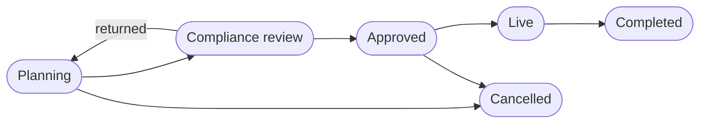
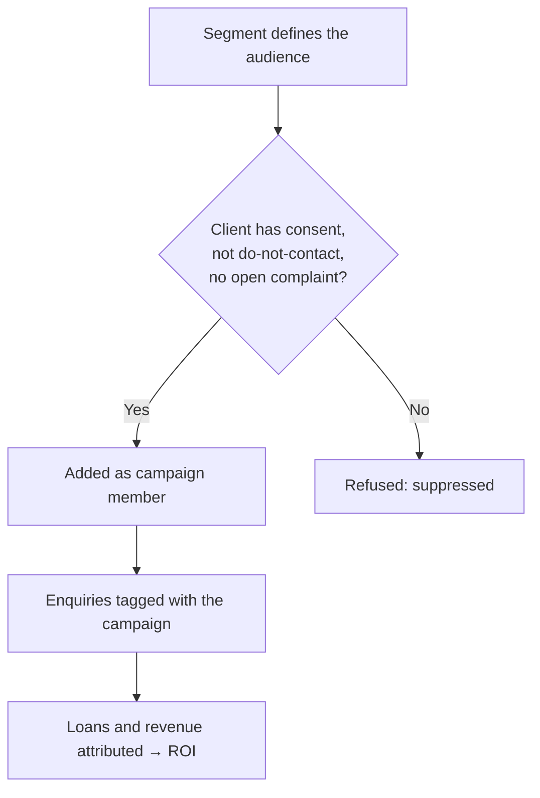

# 14 — Marketing & Consent

<!-- nav:top -->
> **[Docs roadmap](../../README.md)** › **[Process flows](README.md)** › 15 of 22 · **For:** Business users
> ← [13 — Forex Desk](13-forex-desk.md) · [15 — Introducers](15-introducers.md) →
> New to Genesis? Background: [Understanding Genesis › Who sees what](../../understanding/05-who-sees-what.md)
<!-- /nav:top -->

**Sidebar:** Growth ▸ Marketing & Consent

## What it is for

Plans and runs marketing within the client's consent. Campaigns carry a budget, an audience and the enquiries, loans
and revenue they produce, so ROI is measured. Segments define audiences; events track registrations and attendance;
subscriptions decide who receives newsletters and research. Consent is recorded per purpose and channel and can be
withdrawn at any time.

## Who works here

| Role | Does |
|---|---|
| Marketing executive | Builds segments, runs campaigns, events and subscriptions |
| RM | Follows up event attendees and campaign responses |
| Compliance | Watches consent and suppression |
| Client | Grants or withdraws consent (also in the portal) |

## Records

| Record | Holds |
|---|---|
| **Campaign** | Budget, actual cost, audience, attributed enquiries, loans and revenue, ROI |
| **Campaign Member** | Client in the campaign, channel, sent date, opened |
| **Segment** | Filter criteria for an audience |
| **Event & Seminar** / **Registration** | Event details; each registration with attendance and follow-up |
| **Newsletter & Research Subscription** | Topic and status per subscriber |
| **Consent** | Purpose (marketing, research, profiling, group sharing), channel, source, text version, withdrawal date |

## The flow at a glance

## Step by step

### A. Campaign

| Step | Who | What to do | What the CRM does |
|---|---|---|---|
| 1 | Marketing | Build a **Segment** with filter criteria | — |
| 2 | Marketing | **New** campaign at *Planning* with budget, audience, dates, message and tracking code ▸ **Compliance review** | Sends the sign-off to Compliance in Approvals; approval moves it to *Approved*, a return to *Planning*. *Approved* and *Live* refuse a campaign without the sign-off |
| 3 | Marketing | Add members from the segment | Refuses any client who is **suppressed**: no consent, do-not-contact, or an open complaint |
| 4 | Marketing | ▸ **Live**; send through the chosen channel | Records sent date and opens per member |
| 5 | — | As responses arrive | Enquiries carrying the campaign (or its UTM tags) are attributed; loans and revenue that follow roll up to the campaign |
| 6 | Marketing | Record actual cost ▸ **Completed** | Calculates ROI |

### B. Event

1. Create the **Event & Seminar**; take **Registrations** (staff or web).
2. Mark attendance on the day.
3. Each registration is assigned to the guest's RM; marking attendance notifies the RM to **follow up**, who ticks
   *Follow-up done*.

### C. Newsletter and research

1. A website **newsletter sign-up** is welcomed by email and creates a subscription.
2. Research is sent with **Send to subscribers** on the publication ([flow 11](11-trading-solutions.md)), in each
   subscriber's language, skipping anyone suppressed.

### D. Consent

1. Consent is first captured on the enquiry form (with the consent text version) and recorded at conversion.
2. Staff or the client (portal **My consents**) grant or withdraw consent per purpose and channel.
3. Withdrawal takes effect at once: the client is suppressed from further marketing.

## Where to see results

- **Marketing** dashboard: ROI by campaign, attributed revenue, events, subscribers, introducers.
- **Compliance** dashboard: consents.

## Related flows

[Enquiries & Leads](03-enquiries-and-leads.md) · [Trading Solutions — research](11-trading-solutions.md) ·
[Service & Complaints](17-service-and-complaints.md) · [Client Portal](21-client-and-introducer-portal.md)

<!-- nav:bottom -->

---

### Where to next

| | |
|---|---|
| **Next** | [15 — Introducers](15-introducers.md) — Introducers, referrals and commissions |
| **Previous** | [13 — Forex Desk](13-forex-desk.md) |
| **Background** | [Understanding Genesis › Who sees what](../../understanding/05-who-sees-what.md) |
| **Lost?** | [Docs roadmap](../../README.md) · [Process flows](README.md) · [Understanding Genesis](../../understanding/README.md) |
<!-- /nav:bottom -->
