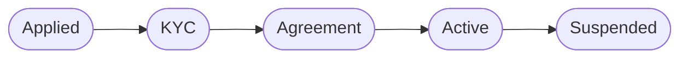
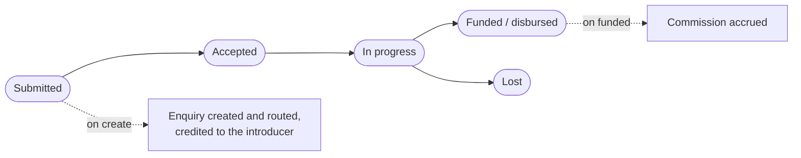

# 15 — Introducers

<!-- nav:top -->
> **[Docs roadmap](../../README.md)** › **[Process flows](README.md)** › 16 of 22 · **For:** Business users
> ← [14 — Marketing & Consent](14-marketing-and-consent.md) · [16 — Revenue](16-revenue.md) →
> New to Genesis? Background: [Understanding Genesis › What happens automatically](../../understanding/06-what-happens-automatically.md)
<!-- /nav:top -->

**Sidebar:** Growth ▸ Introducers

## What it is for

Manages external partners — brokers, agents, notaries, accountants and insurance agents — who refer clients for a
commission. Introducers are onboarded with KYC and an agreement, submit referrals (also through the introducer
portal), and earn commission on funded business, with clawback if the business is cancelled early.

## Who works here

| Role | Does |
|---|---|
| Head of BD & partnerships | Onboards introducers, owns referrals, approves commissions |
| Compliance | Approves the introducer's KYC |
| Desk receiving the enquiry | Works the referred client as a normal enquiry |
| Introducer | Submits and follows referrals in the portal |

## Records

| Record | Holds |
|---|---|
| **Introducer & Partner** | Type, allowed products, commission %, clawback terms, protection window, agreement date, KYC status |
| **Introducer Referral** | Prospect details, product, estimated and funded amount, linked enquiry |
| **Commission** | Base amount, commission due, status (accrued, paid, clawed back) |

## The flow at a glance

Onboarding the introducer:

A referral:

## Step by step

### A. Onboard an introducer

| Step | Who | What to do | What the CRM does |
|---|---|---|---|
| 1 | BD head | **New** introducer at *Applied* | — |
| 2 | BD head / Compliance | Run KYC on the introducer ▸ **KYC** | — |
| 3 | BD head | Sign the agreement; set commission %, allowed products, clawback and protection window ▸ **Agreement** | Agreement date and commission % required |
| 4 | BD head | ▸ **Active** | Refused unless the introducer's KYC is approved; the introducer can sign in to the portal |

### B. A referral

| Step | Who | What to do | What the CRM does |
|---|---|---|---|
| 1 | Introducer / BD | Submit the referral in the portal, or **New** referral in the CRM | Creates an **enquiry** (channel *introducer*) attributed to the introducer and routes it to the right desk ([flow 03](03-enquiries-and-leads.md)) |
| 2 | BD head | ▸ **Accepted** ▸ **In progress** as the desk works it | The introducer sees the stage only if the prospect agreed to share it |
| 3 | BD head | Business funded ▸ **Funded / disbursed** with funded amount | Accrues a **Commission** on the funded volume |
| 4 | BD head | Not proceeding ▸ **Lost** | — |
| 5 | Finance / BD | Pay commissions; record clawback if the business is cancelled early | Commissions visible to the introducer in the portal |

## Rules and controls

- An introducer is active only after KYC approval and a signed agreement.
- Credit applies inside the protection window.
- Referral status is shown to the introducer only with the prospect's consent.

## Where to see results

- **Marketing** dashboard: introducers.
- **Revenue** ledger and exports for commission payments.

## Related flows

[Enquiries & Leads](03-enquiries-and-leads.md) · [Revenue](16-revenue.md) ·
[Introducer Portal](21-client-and-introducer-portal.md)

<!-- nav:bottom -->

---

### Where to next

| | |
|---|---|
| **Next** | [16 — Revenue](16-revenue.md) — Revenue entries and how they roll up |
| **Previous** | [14 — Marketing & Consent](14-marketing-and-consent.md) |
| **Background** | [Understanding Genesis › What happens automatically](../../understanding/06-what-happens-automatically.md) |
| **Lost?** | [Docs roadmap](../../README.md) · [Process flows](README.md) · [Understanding Genesis](../../understanding/README.md) |
<!-- /nav:bottom -->
