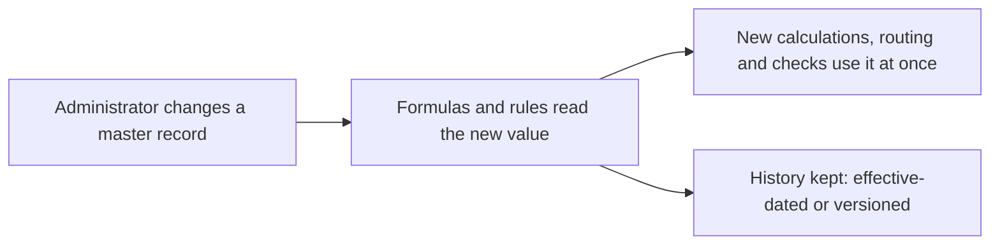

# 19 — Masters

<!-- nav:top -->
> **[Docs roadmap](../../README.md)** › **[Process flows](README.md)** › 20 of 22 · **For:** Administrators
> ← [18 — KYC & Compliance](18-kyc-and-compliance.md) · [20 — Tools](20-tools.md) →
> New to Genesis? Background: [Understanding Genesis › The building blocks](../../understanding/02-building-blocks.md)
<!-- /nav:top -->

**Sidebar:** Masters

## What it is for

The reference data that drives the CRM's formulas, routing and rules. Masters are ordinary records maintained by
administrators, so a change — a new PLR, a new haircut, a new approval limit — takes effect at once with no software
release.

## Who works here

| Role | Does |
|---|---|
| CRM administrator | Maintains the masters |
| Forex dealer | Updates the daily FX board |
| Compliance | Owns country risk and KYC risk factors |
| Everyone | Reads them |

## Records and what each one drives

| Master | Drives |
|---|---|
| **Product routing** | Website label → product code, business unit, queue, first-contact target ([flow 03](03-enquiries-and-leads.md)) |
| **PLR history** | Effective-dated Prime Lending Rate → loan pricing, **Rate from**, PLR change notices ([flow 08](08-loan-servicing.md)) |
| **Countries** | FATF status, sanctions, risk score → KYC risk score |
| **FX reference rates** | Daily TT buy and sell → MUR conversions, rate alerts, website feed ([flow 13](13-forex-desk.md)) |
| **Model portfolios** | A–E allocations → risk profiles and suitability ([flow 09](09-wealth-management.md)) |
| **KYC risk factors** | Versioned weights → KYC risk rating ([flow 18](18-kyc-and-compliance.md)) |
| **Collateral types & haircuts** | Haircut, revaluation frequency, LTV warning / margin-call / liquidation thresholds ([flow 07](07-collateral-and-pledges.md)) |
| **Approval matrices** | Who approves which amount or exception ([flow 05](05-retail-lending.md), [flow 06](06-commercial-lending.md)) |
| **Service catalogue** | Request types with SLA and approval flag ([flow 17](17-service-and-complaints.md)) |
| **Reason codes** | Disqualification, decline and dismissal reasons |
| **Funds & share classes** | Fund facts, minimums, cut-offs ([flow 10](10-investment-funds.md)) |

Products themselves are in [Products & Services](01-products-and-services.md).

## The flow at a glance

## Step by step: changing the PLR (example)

| Step | Who | What to do | What the CRM does |
|---|---|---|---|
| 1 | Administrator | **Masters ▸ PLR history ▸ New**: new rate and effective date | Rate from on products and pricing on new applications update |
| 2 | Loans Manager | Create and approve the PLR Change Campaign | Daily sweep sends every variable-rate borrower a personalised notice |

The same pattern applies to every master: edit the record; everything that reads it follows.

## Rules and controls

- Business units, roles, staff and business hours are Builder settings, not masters.
- Changes are recorded in each record's Audit tab.

## Related flows

All modules read the masters; see the links in the table above.

<!-- nav:bottom -->

---

### Where to next

| | |
|---|---|
| **Next** | [20 — Tools](20-tools.md) — Approvals, reminders, reports, access & barriers, SLA board, documents, web forms |
| **Previous** | [18 — KYC & Compliance](18-kyc-and-compliance.md) |
| **Background** | [Understanding Genesis › The building blocks](../../understanding/02-building-blocks.md) |
| **Lost?** | [Docs roadmap](../../README.md) · [Process flows](README.md) · [Understanding Genesis](../../understanding/README.md) |
<!-- /nav:bottom -->
