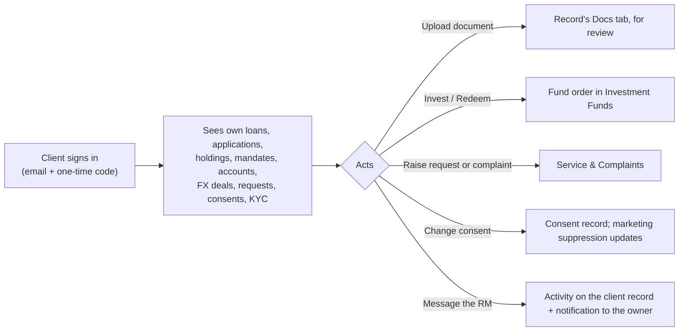

# 21 — Client & Introducer Portal

<!-- nav:top -->
> **[Docs roadmap](../../README.md)** › **[Process flows](README.md)** › 22 of 22 · **For:** Business users
> ← [20 — Tools](20-tools.md) · [Tutorial videos](../videos/README.md) *(Tutorial videos)* →
> New to Genesis? Background: [Understanding Genesis › Who sees what](../../understanding/05-who-sees-what.md)
<!-- /nav:top -->

**Address:** `/portal/<workspace>` (demo: `/portal/genesis-capital`) · website preview: `/site/<workspace>`

## What it is for

A secure website where clients follow and act on their business with the group, and introducers submit and follow
referrals. Everything they do lands in the CRM on the right record for staff to act on.

## Who uses it

| User | Signs in with |
|---|---|
| Client | The email on their client record and a one-time code |
| Introducer | Their portal email and a one-time code |

Portal sign-ins are a separate realm: they can never reach staff screens.

## The flow at a glance

## Step by step — client

| Step | Client does | What lands in the CRM |
|---|---|---|
| 1 | Signs in with email and the one-time code | — |
| 2 | **Loan applications**: follows status and figures; uploads requested documents | Uploads on the application's Docs tab ([flow 05](05-retail-lending.md)) |
| 3 | **My loans**: sees outstanding balance, rate, instalment, next due date | — |
| 4 | **Fund holdings**: **Redeem** a holding (units or amount); **Fund orders**: **+ Invest** | A fund order, subject to cut-off, KYC, minimum and suitability rules; then maker-checker ([flow 10](10-investment-funds.md)). Switches go through the RM |
| 5 | Views **wealth mandates**, **trading accounts**, **FX deals** | — |
| 6 | **Requests & complaints**: raises one and attaches documents | A service request or complaint, acknowledged automatically ([flow 17](17-service-and-complaints.md)) |
| 7 | **My consents**: grants or withdraws per purpose | Consent record updated ([flow 14](14-marketing-and-consent.md)) |
| 8 | **Know your customer**: uploads a renewed ID or proof of address | On the KYC case for review ([flow 18](18-kyc-and-compliance.md)) |
| 9 | Downloads letters and reports shared with them; messages the RM | Message as an activity; owner notified |

New loan applications start from the website forms (calculator or enquiry), not inside the portal.

## Step by step — introducer

| Step | Introducer does | What lands in the CRM |
|---|---|---|
| 1 | Signs in | — |
| 2 | Submits a referral | An introducer referral and a routed enquiry credited to them ([flow 15](15-introducers.md)) |
| 3 | Follows their referrals | Stage shown only where the prospect agreed to share it |
| 4 | Views commissions | Accrued and paid commissions |

## Website preview and feeds

`/site/<workspace>` shows, with no sign-in, the FX rate board, the PLR, fund NAVs with a performance chart and every
published form — all straight from the CRM. The same read-only feeds (FX rates, fund NAV, NAV history, PLR) can drive
the public website. Personal data is never published.

## Related flows

[Enquiries & Leads](03-enquiries-and-leads.md) · [Investment Funds](10-investment-funds.md) ·
[Service & Complaints](17-service-and-complaints.md) · [Tools — documents and web forms](20-tools.md)

<!-- nav:bottom -->

---

### Where to next

| | |
|---|---|
| **Next** | [Tutorial videos](../videos/README.md) *(Tutorial videos)* — Twenty captioned videos: getting started and one end-to-end process per module |
| **Previous** | [20 — Tools](20-tools.md) |
| **Background** | [Understanding Genesis › Who sees what](../../understanding/05-who-sees-what.md) |
| **Lost?** | [Docs roadmap](../../README.md) · [Process flows](README.md) · [Understanding Genesis](../../understanding/README.md) |
<!-- /nav:bottom -->
