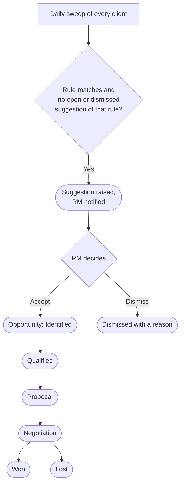

# 04 — Cross-sell & RM Workbench

**Sidebar:** Client 360 ▸ Cross-sell & RM Workbench

## What it is for

Turns the group's knowledge of a client into the next sale. Every day the CRM checks each client against
**next-best-action** rules and suggests the product another entity could offer. Accepted suggestions become
**opportunities** with value and probability. RMs log structured meeting notes and track quarterly targets.

## Who works here

| Role | Does |
|---|---|
| Relationship manager | Works suggestions and opportunities, logs meetings |
| Managers | Set targets, follow the league table |
| Any desk | Raises referrals and shares credit |

## Records

| Record | Holds |
|---|---|
| **Next-Best Action** | Rule, product, entity, reason, status (open, accepted, dismissed) |
| **Opportunity** | Party, entity, product, value, probability, forecast category, weighted value, referrer credit |
| **Meeting Note** | Discovery, review, credit visit, call or event follow-up |
| **RM Target & Quota** | Quarterly targets and attainment |

## The flow at a glance

### The daily rules

| Client looks like | Suggestion |
|---|---|
| Fund holdings ≥ MUR 1 million and no loan | Investment-Backed Loan (liquidity without selling) |
| Loan exposure ≥ MUR 3 million and no investments | Wealth account or Money Market Fund |
| Company in tourism, trade or manufacturing with no FX profile | Forward hedging |
| HNW / UHNW without a wealth mandate | Wealth discovery meeting |
| FMB 2029 holding within six months of maturity | Reinvestment proposal |
| Loan within six months of maturity | Retention / new-need conversation |
| Securities account with no trade for 12 months | Reactivation with latest research |
| Real-estate loan ≥ MUR 5 million just disbursed | Referral to Wealth |

## Step by step

| Step | Who | What to do | What the CRM does |
|---|---|---|---|
| 1 | — | Daily | Runs the rules above; raises a suggestion once per rule per client and notifies the RM |
| 2 | RM | Review suggestions on **My Workbench** or the client's Related tab | — |
| 3a | RM | **Accept** | Opens an **Opportunity** at *Identified* with probability 25% and the referrer credited |
| 3b | RM | **Dismiss** with a reason | The rule does not suggest it again for this client |
| 4 | RM | Meet the client; add a **Meeting Note** from the right template | Meeting appears in the RM's calendar feed |
| 5 | RM | Move the opportunity through *Qualified → Proposal → Negotiation* and update value and probability | Calculates weighted value (value × probability) |
| 6 | RM | Close as **Won**, or **Lost** with a loss reason | Won business counts toward the RM's target; credit can be split with the referrer |
| 7 | Manager | Set **RM Targets** each quarter | Calculates attainment |

## Where to see results

- **My Workbench**: my enquiries, next-best actions, reviews, KYC, pipeline, meetings.
- **RM League Table**: meetings, revenue credited, pipeline, wins and target attainment per RM.
- **Group Executive**: cross-sell.

## Related flows

[Clients](02-clients-client-360.md) · [Revenue](16-revenue.md) · [Investment Funds](10-investment-funds.md) ·
[Forex Desk](13-forex-desk.md)
