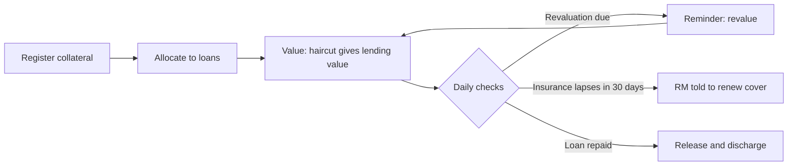
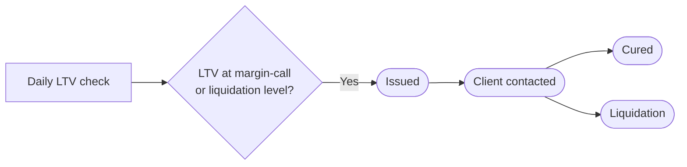

# 07 — Collateral & Pledges

**Sidebar:** Lending ▸ Collateral & Pledges

## What it is for

Holds every asset given as security — property, land, fund units, securities, cash, guarantees — with its value,
haircut and lending value. Keeps valuations and insurance current, and protects investment-backed loans by watching
LTV every day and issuing margin calls.

## Who works here

| Role | Does |
|---|---|
| Loans executive / RM | Registers collateral and allocates it to loans |
| Credit / risk | Reviews valuations and LTV |
| RM | Contacts the client on a margin call |
| Operations | Records pledges with the transfer agent or custodian |

## Records

| Record | Holds |
|---|---|
| **Collateral** | Type, owner, title, rank, value, valuer, haircut, lending value, insurance and expiry, next revaluation, pledge status, release date |
| **Collateral Allocation** | Links one collateral to one or more loans (many-to-many) |
| **Collateral Valuation** | Each valuation with date and valuer |
| **Margin Call** | LTV at call, cure, outcome |

## The flow at a glance

Register and maintain:

Margin call on an investment-backed loan:

## Step by step

| Step | Who | What to do | What the CRM does |
|---|---|---|---|
| 1 | Loans executive | **New** collateral: type, owner, title, rank, value, valuer, insurance | Applies the type's **haircut** from Masters to give the **lending value**; sets the next revaluation date from the type's frequency |
| 2 | Loans executive | Add a **Collateral Allocation** to each loan it secures | Security value rolls up to the loan; feeds *security complete* on the application ([flow 05](05-retail-lending.md)) |
| 3 | Operations | For fund units or securities, record the **pledge** with the TA / custodian | Pledged fund units show on the client's holding |
| 4 | — | Daily | Revaluation due → reminder; insurance lapsing in 30 days → RM told (a lapse is a breach) |
| 5 | Valuer / credit | Record a **Collateral Valuation** | Updates value and lending value |
| 6 | — | Daily, investment-backed loans | Reads NAVs and prices; compares LTV with the type's warning, margin-call and liquidation thresholds |
| 7 | — | Threshold reached | Creates a **Margin Call** at *Issued*; emails the borrower in their language, sends an SMS, alerts the RM |
| 8 | RM | Call the client ▸ **Client contacted**; agree extra collateral or a repayment | — |
| 9 | RM | Cured ▸ **Cured**; not cured ▸ **Liquidation** | — |
| 10 | Loans executive | Loan repaid: set the release date and generate the discharge | — |

## Timers (SLAs)

| Timer | Target |
|---|---|
| Margin call cured | 5 business days |

## Where to see results

- **Loan Book** dashboard: LTV bands.
- **SLA Board**: open margin calls.

## Related flows

[Retail Lending](05-retail-lending.md) · [Loan Servicing](08-loan-servicing.md) ·
[Investment Funds](10-investment-funds.md) · [Masters — haircuts](19-masters.md)
