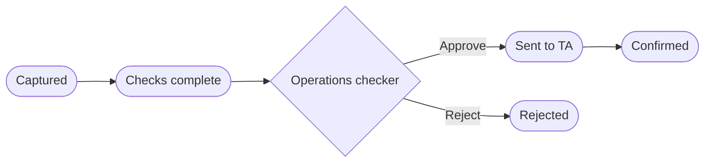

# 10 — Investment Funds

**Sidebar:** Investments ▸ Investment Funds

## What it is for

Distributes the group's funds. Fund orders — subscriptions, redemptions and switches — are checked for KYC, minimum
investment and suitability, approved by an operations checker, sent to the transfer agent (TA) and confirmed to the
investor. Holdings and NAV history are kept, NAVs are published to the website, and fund campaigns such as the Fixed
Maturity Bond (FMB) 2029 series are tracked.

## Who works here

| Role | Does |
|---|---|
| Fund manager / RM | Captures orders, runs campaigns |
| Operations checker | Checks and releases orders (never the maker) |
| Client | Places orders through the RM or the portal (*Invest*, *Redeem*) |

## Records

| Record | Holds |
|---|---|
| **Fund** / **Fund Share Class** | ISIN, currency, risk, minimums, fees, dealing frequency, cut-off, latest NAV |
| **NAV History** | NAV per date (published to the website feed) |
| **Fund Holding** | Units, value, gain, pledged units |
| **Fund Order** | Type, share class, amount, payment proof, suitability override, TA reference |
| **Fund Campaign** | *Planned → Window open → Allocating → Closed*, target and progress |
| **Dividend & Distribution Notice** | Income paid to unitholders |

## The flow at a glance

## Step by step

### A. Subscription, redemption or switch

| Step | Who | What to do | What the CRM does |
|---|---|---|---|
| 1 | Fund manager / RM | **Fund Orders ▸ New**: client, share class, order type, amount (or the client uses **+ Invest** / **Redeem** in the portal) | Refused if KYC is not approved, if a subscription is below the share-class minimum, or if the fund is riskier than the client's profile without an override and acknowledgement |
| 2 | Fund manager | Tick *Payment proof received* ▸ **Checks complete** | Sends an approval to the **operations checker**; the maker cannot approve |
| 3 | Operations checker | **Tools ▸ Approvals** ▸ Approve | Sends the order to the **transfer agent**, records the TA reference, moves to **Confirmed** and emails the investor a confirmation |
| 3b | Operations checker | Reject with a comment | Moves to **Rejected** |
| 4 | — | After confirmation | Holding updates; fund holdings roll up to the client's Client 360 |

### B. Fund campaign (FMB 2029 series)

1. Create the **Fund Campaign** at *Planned* with the target raise.
2. ▸ **Window open**: orders link to the campaign; progress % updates.
3. ▸ **Allocating** ▸ **Closed** at the end of the window.
4. Six months before an FMB holding matures, the CRM raises a **reinvestment** next-best action for the RM.

### C. NAVs and distributions

1. Record each NAV in **NAV History**; the website feed shows NAVs and a performance chart.
2. Create a **Distribution Notice** and mark it *Published*: the fund team is told to distribute it to unitholders.

## Rules and controls

- KYC approved, minimum investment met, and suitability (or a documented override and client acknowledgement) — all
  checked on the order itself.
- Maker-checker on every order.
- A switch between funds from the portal is requested through the RM.

## Timers (SLAs)

| Timer | Target |
|---|---|
| Order checked and sent to the TA | Half a business day (before the dealing cut-off) |

## Where to see results

- **Investment Funds** dashboard: holdings by fund, subscriptions vs redemptions, FMB 2029 progress.
- **Group Executive**: fund holdings.

## Related flows

[Wealth Management](09-wealth-management.md) · [Collateral — pledged units](07-collateral-and-pledges.md) ·
[Client Portal](21-client-and-introducer-portal.md) · [Tools — approvals](20-tools.md)
