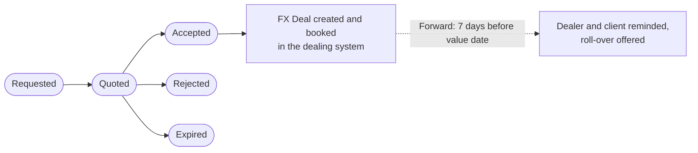
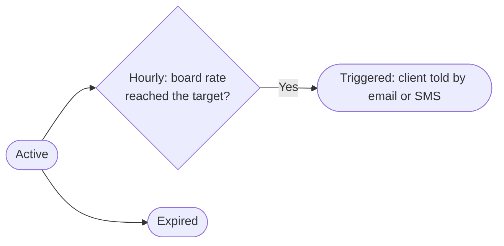

# 13 — Forex Desk

**Sidebar:** Advisory ▸ Forex Desk

## What it is for

Runs the foreign-exchange business: client FX profiles, quotes that become deals booked in the dealing system, rate
alerts that tell clients when a target rate is reached, and reminders before forwards mature. The daily TT board
rates are published to the website.

## Who works here

| Role | Does |
|---|---|
| Forex dealer | Quotes, books deals, manages alerts and forwards |
| Corporate RM | Introduces hedging needs |
| Client | Requests quotes, sets rate alerts |

## Records

| Record | Holds |
|---|---|
| **FX Client Profile** | Purpose, volumes, currency pairs, approved products, limits, settlement accounts |
| **FX Quote** | Product (spot, forward, swap), side, currency, amount, quoted rate and time |
| **FX Deal** | Deal rate, dealing-system reference, value date, improvement against the board rate, BoM purpose code |
| **FX Rate Alert** | Currency, target, direction, channel (email or SMS) |
| **FX Reference Rates** (Masters) | The daily TT buying and selling board |

## The flow at a glance

Rate alerts:

## Step by step

### A. Quote to deal

| Step | Who | What to do | What the CRM does |
|---|---|---|---|
| 1 | Dealer | Make sure the client has an **FX Client Profile** with approved products and limits | — |
| 2 | Dealer | **FX Quotes ▸ New**: client, profile, product, side, currency, amount ▸ *Requested* | Starts the quote timer |
| 3 | Dealer | Enter the quoted rate and time ▸ **Quoted** | Both fields required |
| 4 | Dealer | Client agrees ▸ **Accepted** (response time recorded) | Creates the **FX Deal**, books it in the dealing system and records the reference; calculates improvement against the board rate |
| 4b | Dealer | Client declines or time runs out ▸ **Rejected** / **Expired** | Feeds quote-outcome reporting |
| 5 | — | Forward deals, 7 days before the value date | Reminds the client and the dealer and offers a roll-over |

### B. Rate alert

1. Dealer (or client request) creates an **FX Rate Alert** with currency, target and direction.
2. Every hour the CRM compares the board rate with the target.
3. When it is reached, the client is emailed or texted and the alert is closed as *Triggered*.

### C. Daily board

The dealer updates **Masters ▸ FX Reference Rates** each day. The board feeds MUR conversions across the CRM, the
rate alerts and the website feed.

## Rules and controls

- Deals carry a Bank of Mauritius purpose code for regulatory reporting.
- Corporates in tourism, trade or manufacturing without an FX profile get an **FX hedging** next-best action.

## Timers (SLAs)

| Timer | Target |
|---|---|
| Quote answered | 15 business minutes (best execution) |

## Where to see results

- **Forex Desk** dashboard: volume by currency and month, top clients, quote outcomes, rate alerts.
- **Regulatory Extracts**: FX by BoM purpose code.
- FX value dates appear in each dealer's calendar feed.

## Related flows

[Commercial Lending](06-commercial-lending.md) · [Cross-sell](04-cross-sell-and-rm-workbench.md) ·
[Masters](19-masters.md)
