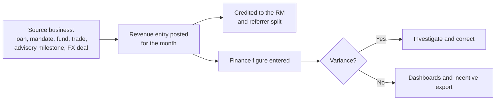

# 16 — Revenue

**Sidebar:** Growth ▸ Revenue

## What it is for

One ledger of the revenue every business earns from its clients, credited to the RM and to any referring RM, and
reconciled to the finance figures. It feeds the executive and league-table dashboards and the incentive exports.

## Who works here

| Role | Does |
|---|---|
| Finance / operations | Posts and reconciles revenue entries |
| Managers | Read revenue by entity, product and RM |
| RMs | See revenue credited to them |

## Records

| Record | Holds |
|---|---|
| **Revenue Entry** | Client, business unit, product, type, amount, currency, period (month), booked date, RM credited, referrer and split %, finance figure for reconciliation |
| **Fee Invoice** | Advisory retainer, milestone, success and expense invoices with status (draft, sent to accounting, issued, paid, overdue) |
| **Commission** | Introducer commissions ([flow 15](15-introducers.md)) |

Revenue types: loan arrangement / processing fee · interest income (LMS summary) · management fee · performance fee ·
brokerage · advisory retainer · advisory success fee · FX spread income.

## The flow at a glance

## Step by step

| Step | Who | What to do | What the CRM does |
|---|---|---|---|
| 1 | Finance | Post a **Revenue Entry** per client, product and month (or import the monthly file) | Converts to MUR at the FX board rate |
| 2 | — | Advisory deliverable delivered with a milestone fee | Raises the **Fee Invoice** automatically ([flow 12](12-corporate-advisory.md)); once it is **Paid**, posts the fee to the ledger |
| 2a | — | FX dealer books a deal | Posts the spread income over the mid rate, credited to the dealer, with the deal as its **Source** |
| 3 | Finance | Set the RM credited and, for referred business, the referrer and split % | Splits credit between RMs |
| 4 | Finance | Enter the **finance figure** from the accounting system | Shows the variance; **Reconciliation** reads *Reconciled* or *Variance to investigate* |
| 5 | Managers | Search the ledger (entity, type, month) and **Export** for incentives | Exports the rows shown, with labels and names |

## Where to see results

- **Group Executive**: revenue by entity and month.
- **RM League Table**: revenue credited per RM, and referral credit per referring RM.
- **Marketing**: attributed revenue and campaign ROI.

## Related flows

[Cross-sell](04-cross-sell-and-rm-workbench.md) · [Corporate Advisory](12-corporate-advisory.md) ·
[Introducers](15-introducers.md)
