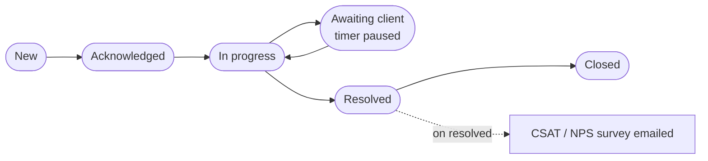

# 17 — Service & Complaints

**Sidebar:** Service ▸ Service & Complaints

## What it is for

Every client request after onboarding — address change, statement, early settlement quote, redemption, top-up, title
release — and every complaint. Request types come from a catalogue, each with its own timer and, where needed, an
approval. Complaints form the FSC-aligned register: acknowledged automatically, routed to Compliance, and never
resolved without a root cause and a final response. A satisfaction survey follows.

## Who works here

| Role | Does |
|---|---|
| RM / service staff | Log and resolve requests |
| BD / business-unit head | Approves requests the catalogue marks as needing approval |
| Compliance officer | Oversees every complaint |
| Client | Raises requests in person, by phone or email, or in the portal |

## Records

| Record | Holds |
|---|---|
| **Service Request / Complaint** | Client, request type, channel, priority, description, root cause, final response, redress, Ombudsperson referral, CSAT and NPS |
| **Service Catalogue** (Masters) | 13 request types, each with SLA and approval flag |

## The flow at a glance

## Step by step

### A. Service request

| Step | Who | What to do | What the CRM does |
|---|---|---|---|
| 1 | Staff / client | **New**: client, request type from the catalogue, channel, description (or the client raises it in the portal) | Stamps the received date; acknowledges the client in their language; starts the timer by priority |
| 2 | — | If the catalogue marks the type as needing approval | Sends an approval to the business-unit head |
| 3 | Owner | Work it ▸ **In progress**; waiting on the client ▸ **Awaiting client** | The timer pauses while awaiting the client |
| 4 | Owner | ▸ **Resolved** with resolved date | Emails the **satisfaction survey** (CSAT 1–5, NPS 0–10) |
| 5 | Owner | ▸ **Closed** | — |

### B. Complaint

| Step | Who | What to do | What the CRM does |
|---|---|---|---|
| 1 | Anyone | **New**, request type *Complaint* | Emails the complaint acknowledgement, moves it to **Acknowledged**, and notifies Compliance |
| 2 | Owner | Investigate ▸ **In progress** | Client is suppressed from marketing while the complaint is open |
| 3 | Owner | Record **root cause** and **final response** (and redress) ▸ **Resolved** | Refused without both |
| 4 | Owner | If the client refers it on, record the **Ombudsperson for Financial Services** referral | Appears in Regulatory Extracts |
| 5 | — | On resolution | Survey emailed |

## Timers (SLAs)

| Timer | Target |
|---|---|
| Complaint acknowledged | 1 business day |
| Complaint final response | 15 business days |
| Request first response | 1 business day |
| Request resolved, by priority | Critical 1 · High 2 · Medium 5 · Low 10 business days |

Warnings go to the owner; breaches escalate to the manager.

## Where to see results

- **Service & Complaints** dashboard: requests by type and entity, root causes, CSAT, NPS.
- **Compliance** and **Regulatory Extracts**: complaints log, Ombudsperson referrals.

## Related flows

[Loan Servicing](08-loan-servicing.md) · [Wealth — top-ups and withdrawals](09-wealth-management.md) ·
[Client Portal](21-client-and-introducer-portal.md) · [Tools — SLA Board](20-tools.md)
