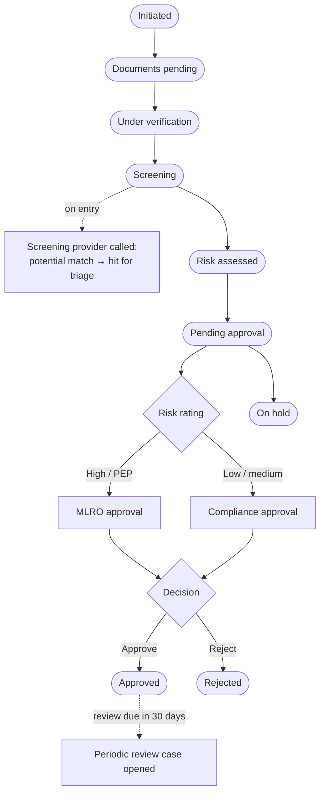

# 18 — KYC & Compliance

**Sidebar:** Compliance ▸ KYC & Compliance

## What it is for

Know-your-customer and anti-money-laundering controls for the whole group, plus the compliance registers. A KYC case
collects documents, screens the client against sanctions and PEP lists, scores the risk, and goes to Compliance — or
the MLRO for high risk — for four-eyes approval. Approved KYC unlocks business everywhere else. Periodic reviews and
ID renewals open by themselves. The module also holds the STR register, restricted and watch lists, conflicts, gifts,
personal dealing and data subject requests.

## Who works here

| Role | Does |
|---|---|
| Loans executive / RM | Prepares the KYC case |
| Compliance officer | Triages screening hits, approves standard and medium-risk KYC, runs the registers |
| MLRO | Approves high-risk and PEP KYC, owns the STR register |
| All staff | Declare gifts, request personal-dealing pre-clearance |

## Records

| Record | Holds |
|---|---|
| **KYC Case** | Documents, screening result, risk factors and score, rating (low / medium / high), EDD notes, FATCA / CRS, outcome, next review date |
| **Screening Hit** | Matched name, list, score, disposition (true match, false positive, escalated), rationale |
| **KYC Reliance Record** | One entity relying on another's approved KYC |
| **STR Register** | *Raised → MLRO review → Filed with FIU / Closed — no filing* (MLRO only) |
| **Restricted & Watch List** | Issuers the group may not trade or that Compliance monitors |
| **Conflicts Register** | Conflicts found by advisory conflict checks |
| **Gifts & Hospitality Register** | Gifts given or received |
| **Personal Dealing Pre-clearance** | Staff trading requests |
| **Data Subject Request (DPA)** | Access, rectification, erasure, portability, objection |

## The flow at a glance

## Step by step

### A. Onboarding KYC

| Step | Who | What to do | What the CRM does |
|---|---|---|---|
| 1 | — | Enquiry converted ([flow 03](03-enquiries-and-leads.md)) | Opens the KYC case at *Initiated* |
| 2 | Owner | ▸ **Documents pending**; send the KYC checklist upload link from the Docs tab | Client uploads ID, proof of address, source of funds / wealth, FATCA / CRS self-certification |
| 3 | Owner | Review documents ▸ tick *documents complete* ▸ **Under verification** | Refused until documents are complete |
| 4 | Owner | ▸ **Screening** | Screens the client; records result, reference and date; a potential match creates a **Screening Hit** and tells Compliance |
| 5 | Compliance | Triage each hit: true match, false positive or escalate, with rationale | A true match or escalation alerts the MLRO |
| 6 | Owner | Fill the risk questions ▸ **Risk assessed** | Scores country, PEP, product, channel, occupation, ownership and activity from the weighted factors in Masters → low / medium / high (an override needs a reason) |
| 7 | Owner | High risk: verify source of wealth and record **EDD** notes ▸ **Pending approval** | Refused unless documents are complete, screening is not a true match and, for high risk, EDD is done. Sends the approval to the **MLRO** (high / PEP) or **Compliance** |
| 8 | Approver | **Tools ▸ Approvals** ▸ Approve or Reject | Approved: outcome and date set, client's KYC status = approved, next review date set (high 1 year, medium 3, low 5). Rejected: owner told not to activate or disburse |

### B. Ongoing

| Trigger | What the CRM does |
|---|---|
| Daily | Rescreens approved clients; new matches become hits |
| Review due within 30 days | Opens a **periodic review** KYC case and tells the owner and Compliance |
| ID expires in 30 days | Emails the client a renewal request with an upload link (or portal upload) and tells the RM |
| Another entity onboards the same client | A **KYC Reliance Record** — allowed only on an approved KYC within its review date |

### C. Suspicious transaction report

1. Anyone raises an **STR** at *Raised*. The MLRO is alerted with no details; the record sits behind the MLRO barrier
   and even its count is hidden (no tipping-off).
2. MLRO ▸ **MLRO review** ▸ **Filed with FIU** (FIU reference and filing date required) or **Closed — no filing**.

### D. Registers

| Register | Flow |
|---|---|
| **Restricted list** | Compliance adds an issuer; traders and portfolio managers are alerted; orders and personal dealing in it are refused. Watch-list entries stay visible to Compliance only |
| **Gifts & hospitality** | Staff declare; above MUR 5,000 goes to Compliance for a decision |
| **Personal dealing** | Staff request pre-clearance; a restricted security is refused automatically, others go to Compliance; clearance lasts two business days |
| **Conflicts** | Fed by advisory conflict checks ([flow 12](12-corporate-advisory.md)) |
| **Data subject request** | *Received → Verifying identity → In progress → Completed / Refused*. Compliance is alerted on receipt; identity must be verified before work starts; completion needs the response and date; refusal needs reasons; AML retention is checked before erasure |

## Rules and controls

- **KYC blocks business:** fund orders, disbursements, trading activation, mandate funding, facility activation,
  relationship activation and introducer activation all require approved KYC.
- **Four eyes:** the person who prepared the case can never approve it.
- **Barriers:** `MLRO_STR` and `COMPLIANCE_ONLY` zones; the audit chain records permission changes, personal-data
  reveals and views of VIP and STR records; **Verify integrity** proves the chain is unaltered.

## Timers (SLAs)

| Timer | Target |
|---|---|
| KYC decided | 5 business days from initiation |
| Data subject request | 30 days (DPA 2017) |

## Where to see results

- **Compliance** dashboard: KYC by stage, risk distribution, screening hits, STRs (MLRO only), complaints, consents,
  data subject requests.
- **Regulatory Extracts**: STRs filed, insiders, complaints.

## Related flows

[Clients](02-clients-client-360.md) · [Retail Lending](05-retail-lending.md) ·
[Corporate Advisory](12-corporate-advisory.md) · [Tools — Access & Barriers](20-tools.md) · [Masters](19-masters.md)
