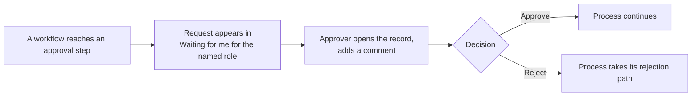
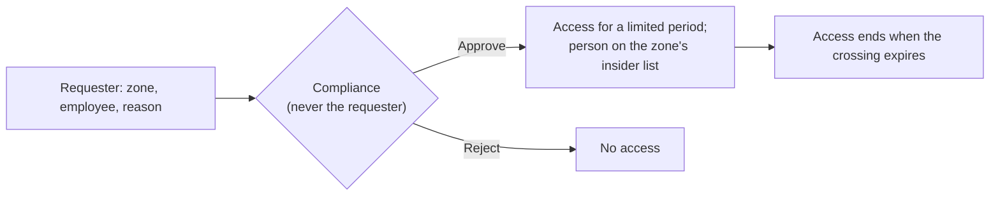
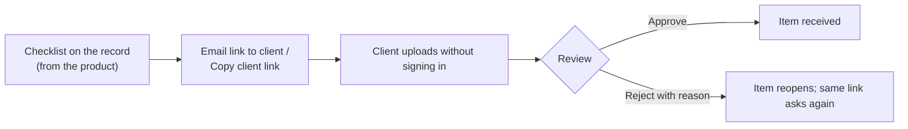

# 20 — Tools: Approvals, Reminders, Reports, Access & Barriers, SLA Board, Documents, Web forms

**Sidebar:** Tools

## What it is for

The shared services every module uses: one inbox for approvals, personal reminders, self-service reports, the
information-barrier controls, the service-level board, the document store and the web forms staff send to clients.

## Who works here

Everyone, within their role. Approvers use **Approvals**; Compliance runs **Access & Barriers**; managers watch the
**SLA Board**.

---

## A. Approvals

| Step | Who | What to do | What the CRM does |
|---|---|---|---|
| 1 | Approver | See the count in the sidebar or follow the bell notification | — |
| 2 | Approver | **Tools ▸ Approvals ▸ Waiting for me** ▸ open the linked record | — |
| 3 | Approver | Comment ▸ **Approve** or **Reject** | Continues the process (for example the loan moves to *Offer issued*) and records the decision in the audit trail |
| 4 | Manager | **All pending** to see every open request | — |

| Request | Approver |
|---|---|
| Loan ≤ MUR 5m / ≤ MUR 20m / above | Loans Manager / Credit Committee / Board Credit Committee |
| KYC standard or medium / high or PEP | Compliance Officer / MLRO |
| Disbursement, fund order | Operations checker |
| Commercial facility | Approval matrix |
| Gift above MUR 5,000 | Compliance |
| Service request needing approval | BD / business-unit head |

The person who started a request never sees it in their own inbox (maker-checker).

## B. Tasks, reminders and calendar

1. **Tasks** (record ▸ Tasks): follow-ups with owner, due date and priority; overdue tasks show on the workbench.
2. **Reminders** (record ▸ Reminders or **Tools ▸ My Reminders**): snooze or complete.
3. **Calendar feed** (avatar ▸ My account ▸ Security ▸ *Show my calendar link*): add to Outlook, Google or Apple
   Calendar to see meetings, due dates, reminders, review dates, covenant tests and FX value dates.

## C. SLA Board

| State | Meaning |
|---|---|
| On track | Within target |
| At risk | Past the warning point (usually 75%) |
| Breached | Past the target; escalated to the manager |
| Met on time / late | Completed before / after the target |
| Paused | Waiting on the client |

Timed items: enquiries, applications, KYC cases, complaints and requests, referrals, disbursements, fund orders, FX
quotes, conflict checks, margin calls, commercial credit, data subject requests.

## D. Access & Barriers (wall-crossing)

| Step | Who | What to do | What the CRM does |
|---|---|---|---|
| 1 | Requester | **Tools ▸ Access & Barriers ▸ Wall-crossings** ▸ zone, employee, reason ▸ *Submit request* | — |
| 2 | Compliance | Approve for a limited period, or reject | Grants access; adds the person to the zone's insider list |
| 3 | — | On expiry | Removes access |

Zones: `ADV_PRIVATE` (advisory), `MLRO_STR` (STRs), `COMPLIANCE_ONLY` (watch list), `VIP_CLIENTS`.

## E. Documents

| Step | Who | What to do | What the CRM does |
|---|---|---|---|
| 1 | Owner | Record ▸ **Docs**: check the checklist (badge counts missing required items) | — |
| 2 | Owner | **Email link to client** (language, validity 14 days by default, up to 60) or **Copy client link** | Sends a signed link naming this record |
| 3 | Client | Opens the link, sees only what is still needed, uploads a PDF, JPEG or PNG (under 10 MB) | Files land on the Docs tab for review |
| 4 | Reviewer | Set *Under review → Approved* or *Rejected* with a reason | A rejected or expired document no longer counts |
| 5 | Owner | **Share** a document by secure, expiring link | Tracks views and downloads |
| 6 | Owner | Send for **e-signature** to named signers | *Pending → Viewed → Signed*; completion certificate filed |

Generated letters (offer, decline, PLR, margin call, KYC refresh, engagement, term sheet) are filed automatically.
Regulated categories are kept seven years. **Document Management** in the sidebar searches all documents.

## F. Web forms

1. **Tools ▸ Web forms** lists every published form (enquiry, loan calculator, quick estimate, investor
   questionnaire, newsletter, call-back).
2. **Email to client** (EN / FR, optional product and note), **Copy link**, or **Open**.
3. **Talk to**: name the staff member the client will deal with; the enquiry is assigned to them.
4. Submissions become records and are routed like any website form ([flow 03](03-enquiries-and-leads.md)).

## G. Reports and dashboards

1. **Tools ▸ Reports ▸ New**: pick the object, filters, grouping and chart.
2. Save, share, schedule by email, or place on a dashboard.
3. Every report and widget counts only records the viewer may see.

## Related flows

All modules use these tools.
